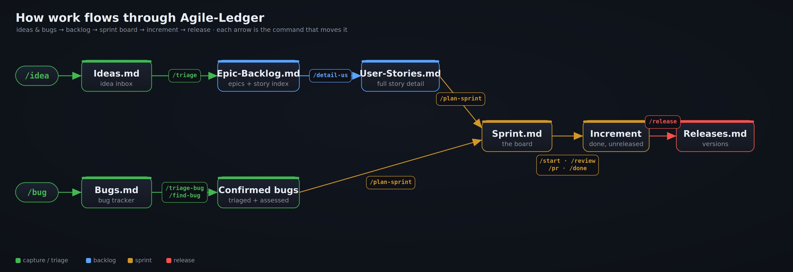
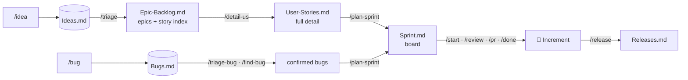
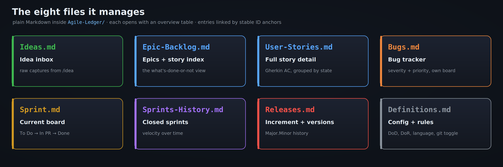
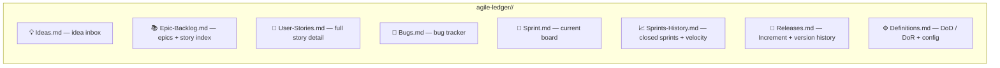

<!-- Cover: docs/assets/cover.png  (generated with Higgsfield — see docs/assets/ASSETS.md) -->
<p align="center">
  
</p>

<h1 align="center">Agile-Ledger Pro</h1>

<p align="center">
  <strong>Plain-Markdown Scrum &amp; Agile product management for Claude Code.</strong><br>
  Run the whole product lifecycle — ideas → backlog → sprint → release, plus bug tracking — from slash
  commands. Just Markdown your whole team can read.
</p>

<p align="center">
  
  
  
  
  
</p>

---

> **Agile-Ledger Pro** is the next generation of
> [Agile-Ledger](https://github.com/nunoamorim99/agile-ledger) — same plain-Markdown ledger format, same
> 34 commands, shipped as the `agile-ledger-pro` plugin. The ledger on disk is **unchanged**: the folder
> is still `agile-ledger/` and the root marker is still a `Registry.md` opening with
> `# Agile-Ledger Registry`, so Pro reads and writes an existing **Agile-Ledger 2.0** ledger with
> nothing to migrate. Switching is an install, not a conversion — see [Install](#install) if you
> already have the original marketplace added. On a **pre-2.0** ledger, `/migrate-ledger` moves it in
> and converts the older file layout.

---

## Why Agile-Ledger Pro

Distributed teams on different schedules don't need another web app to log into — they need a single,
readable source of truth. Agile-Ledger Pro keeps your entire product management layer as plain Markdown in a
**dedicated ledger repository**: one folder per code repo, each with a backlog of epics and user stories,
sprints with velocity, a bug tracker, releases, and a roadmap. **GitHub holds the code; Agile-Ledger Pro
holds the "why", joined by the user-story ID** through every branch, commit, and PR.

- **Your code repos stay clean.** No PM folder in the codebase: a backlog edit never lands on a
  developer's working branch, so nobody rebases or pulls to receive bookkeeping.
- **One place to look.** Every project's ledger sits side by side in one repo you clone once — and one
  history of PM decisions (`ledger(repo-a): US-014 → Done`).
- **Nothing to host, nothing to sync.** It's text in a git repo — diff it, review it, branch it.
- **Readable on anyone's clock.** The board, roadmap, and per-developer views are plain-text snapshots,
  perfect for async teams across time zones.
- **Clickable in preview.** Every ID is a stable anchor link, so you navigate the backlog by clicking —
  index → story → epic → dependency — in GitHub or VS Code preview.
- **Honest by design.** Nothing is auto-registered as truth, nothing is deleted, and reconstructed-from-git
  work is always flagged for human confirmation.

---

## The flow

<p align="center">
  
</p>

<details>
<summary>Mermaid source (editable)</summary>


</details>

## Where it lives — you choose

`/init-ledger` asks where the ledger should go before creating anything. Both answers are first-class;
pick by how many projects you have.

**Inside the project** — one person, one repo. Nothing extra to clone, and the backlog ships with the
code.

```
project-x/                       # your repo
├── src/ · README.md
└── agile-ledger/                # ← the ledger, committed with the project
    ├── Registry.md · Config.md
    └── Ideas.md … Definitions.md    # the eight files, right here
```

**Its own repository** — an organisation, or more than one project. A backlog edit never lands on a
developer's working branch.

```
~/Projetos/                      # your workspace root
├── agile-ledger/                # ← THE LEDGER REPO — its own git repo, cloned once
│   ├── Registry.md              # which repos are managed, and where their code is
│   ├── Config.md                # org, commit/push policy, default repo
│   ├── Me.local.md              # which of the team *you* are — git-ignored, one per clone
│   ├── repo-a/                  # the eight ledger files for repo-a
│   └── repo-b/
└── repo-a/ · repo-b/            # the code repos — no ledger files in them
```

Run `/init-ledger` once. Inside a project it scaffolds the eight files there and then — nothing else to
do. As its own repo, add each project with `/register-repo`, and every command takes `--repo <slug>` to
act on another one from anywhere.

**Once per workspace, not once per person.** Whoever sets the ledger up runs `/init-ledger` and writes
the team into `Config.md`; everybody else clones it and runs **`/whoami`**, which is their whole setup.
It matches them against the roster — by their `gh` login, then their git name — and records the answer
in `Me.local.md` at the ledger root, which `.gitignore` keeps out of git. A ledger that already exists
sends a joiner there rather than asking the setup questions a second time. Identity has to be
per-clone: a name written into a committed file reaches everyone who clones the ledger and is
overwritten by the next person to correct it.

Either way the skill finds the ledger the same way: it walks up from wherever you are, checking each
directory **and its children**, for a `Registry.md` opening with `# Agile-Ledger Registry`. That marker
heading is the only thing it looks for — never a folder name — so `project-x/agile-ledger` is found
from `project-x/src/` exactly as `~/Projetos/agile-ledger` is found from `~/Projetos/repo-a`. Nothing to
configure. Already running the pre-2.0 layout? `/migrate-ledger` moves an in-repo `Agile-Ledger/`
folder into the ledger repo and then offers to clean the code repo on a branch. If that ledger also
predates the eight files — a `Backlog.md` rather than `Ideas.md` + `Epic-Backlog.md` +
`User-Stories.md` + `Bugs.md` — it converts the layout as well, relocating text without rewriting it.

## The eight files it manages (per project)

<p align="center">
  
</p>

<details>
<summary>Mermaid source (editable)</summary>


</details>

Each entry's heading is its **bare ID** (`#### US-014`), which gives it a stable `#us-014` anchor that
survives title changes — the backbone of the clickable navigation. Configure language, story-point
scale, your name, and whether the skill may run `git` in `Definitions.md`.

---

## Commands at a glance

<div align="center">
<table>
<tr>
<td align="center" width="14.2%"><br><sub><b>🟢 Capture</b></sub></td>
<td align="center" width="14.2%"><br><sub><b>🟢 Triage</b></sub></td>
<td align="center" width="14.2%"><br><sub><b>🔵 Backlog</b></sub></td>
<td align="center" width="14.2%"><br><sub><b>🟠 Sprint</b></sub></td>
<td align="center" width="14.2%"><br><sub><b>🟣 Inspect</b></sub></td>
<td align="center" width="14.2%"><br><sub><b>🔴 Release</b></sub></td>
<td align="center" width="14.2%"><br><sub><b>⚫ Workspace</b></sub></td>
</tr>
</table>
</div>

| Group | Commands |
|---|---|
| 🟢 **Capture** | `/idea` · `/bug` |
| 🟢 **Triage** | `/triage` · `/triage-bug` |
| 🔵 **Shape the backlog** | `/detail-us` · `/detail-epic` · `/create-task` · `/find-bug` · `/refine` |
| 🟠 **Plan &amp; run the sprint** | `/plan-sprint` · `/start-us` · `/start-bug` · `/review` · `/pr` · `/done-us` · `/done-bug` · `/close-sprint` |
| 🟣 **Inspect** (read-only) | `/dashboard` · `/board` (`/standup`) · `/my-work` · `/status` · `/roadmap` · `/guide` · `/ledger-check` · `/sync-main` |
| 🔴 **Release** | `/release` · `/changelog` |
| ⚫ **Ledger &amp; repos** | `/init-ledger` · `/whoami` · `/register-repo` · `/migrate-ledger` · `/ledger-commit` · `/discover-repos` · `/workspace-sync` · `/workspace-status` |

Run **`/guide`** in any session for the command-to-file map and a one-glance state summary. The full
reference lives in [`plugins/agile-ledger-pro/README.md`](plugins/agile-ledger-pro/README.md), and a printable
one-page cheat sheet ships as `Agile-Ledger-Pro-cheatsheet.pdf`.

---

## The dashboard

Reading a sprint across eight Markdown files is fine for a commit diff and tiring for a Monday
morning. `/dashboard` serves the whole ledger as a local page — the board, the backlog, every
epic's progress, velocity over time, open bugs — grouped by project, and lets you file an idea,
triage a bug, detail a story, move a card or cut a release without leaving it.

```
/dashboard                      # finds the ledger, opens http://127.0.0.1:4173/
/dashboard --port 4200 --no-browser
```

Python 3.8+, standard library only — nothing to install. It binds `127.0.0.1` and nothing else, so
the ledger is never served to the network. Every write goes through the same rules the commands
follow: nothing is deleted, IDs are never reused, overview tables and epic rollups are rebuilt from
the entries, and an edit replaces only the lines it owns, so the ledger diff shows just your change.
The page reloads itself when the files change, so what you do here in a Claude session shows up in
the browser a couple of seconds later.

A **Commands** tab lists every command the plugin ships — grouped by phase, with what it does, the
file it writes, and whether it runs on the page or in a session — generated from the installed
command files, so it never goes stale. Git-touching work stays in the session on purpose:
`/sync-main`, `/workspace-sync` and `/discover-repos` read git history and propose reconstructed
work that needs your judgement.
Details in [`plugins/agile-ledger-pro/dashboard/README.md`](plugins/agile-ledger-pro/dashboard/README.md).

---

## Quick start

```
/init-ledger                    # once per workspace — creates the ledger repo
/register-repo .                # add the project you're standing in
/whoami                         # once per person — everyone else runs only this
/idea add Google sign-in to speed up onboarding
/triage                         # → epic + a few suggested Draft stories
/detail-us US-014               # → full story in User-Stories.md, linked from the epic
/bug Safari login button does nothing
/triage-bug   →   /find-bug BUG-003
/plan-sprint                    # pulls Ready stories + high-priority bugs within velocity
/start-us US-014  →  /review US-014  →  /pr US-014  →  /done-us US-014
/close-sprint   →   /release
```

## Install

First register the marketplace (once per machine), then install at the scope you want:

```
/plugin marketplace add nunoamorim99/agile-ledger-pro
```

> Two different names are in play here, and mixing them up is the usual cause of a failed install:
> `nunoamorim99/agile-ledger-pro` is the **GitHub `owner/repo`**, while `@nunoamorim99` is the
> **marketplace name** — the `name` field in `.claude-plugin/marketplace.json`. The install format is
> always `<plugin-name>@<marketplace-name>`, i.e. `agile-ledger-pro@nunoamorim99`. The marketplace name
> is the author handle, so every skill installs as `<skill>@nunoamorim99`.

> **Already have the original Agile-Ledger marketplace added?** Both repositories publish a marketplace
> named `nunoamorim99`, so Claude Code treats them as the same one and only the first registered wins.
> Remove the old one first — `/plugin marketplace remove nunoamorim99` — then add this one.

### Scopes

| Scope | Who gets it | How |
|---|---|---|
| **User** (default) | just you, all your projects | `claude plugin install agile-ledger-pro@nunoamorim99 --scope user` |
| **Project** | everyone who opens the ledger repo | commit a `.claude/settings.json` (below) |
| **Local** | just you, this repo only (gitignored) | `claude plugin install agile-ledger-pro@nunoamorim99 --scope local` |

Or run `/plugin` → **Discover** → select **agile-ledger-pro** → choose a scope in the UI.

### Project scope — the whole team gets it

Project scope is not really an "install" — it's a file you commit. Put it in the **ledger repo** (create
`.claude/settings.json` if it doesn't exist; **merge** these keys if it does), so the plugin travels with
the ledger and the code repos stay clean. Teammates who want the commands while standing in a code repo
install at user scope instead:

```json
{
  "extraKnownMarketplaces": {
    "nunoamorim99": {
      "source": { "source": "github", "repo": "nunoamorim99/agile-ledger-pro" }
    }
  },
  "enabledPlugins": {
    "agile-ledger-pro@nunoamorim99": true
  }
}
```

`extraKnownMarketplaces` makes the marketplace known to everyone in the repo; `enabledPlugins` turns the
plugin on. When a teammate opens the folder and trusts it, Claude Code prompts them to install the
marketplace and enable the plugin — no manual setup, and updates are a normal pull request.

> A copy of this file ships at [`install/project.settings.json`](install/project.settings.json) — drop it
> into your project's `.claude/` folder. Note: the two keys must be declared **together** at project
> scope. Trying `--scope project` interactively while the marketplace is only known at user scope is a
> common cause of a project-scope install error; committing both keys avoids it. Teammates are prompted
> to install/trust (plugins run code, so this confirmation is by design and can't be fully silent yet).

### Other ways

Every download below is on the **[latest release](https://github.com/nunoamorim99/agile-ledger-pro/releases/latest)** page — you don't need to clone the repo or hunt for folders.

| You want | Download | Then |
|---|---|---|
| Claude Code without a marketplace (offline, corporate policy, or just to read the files first) | `agile-ledger-pro-<version>.zip` | Unzip into your project's `.claude/` folder — or `~/.claude/` for every project. Restart Claude Code. |
| Claude.ai **web or desktop** | `agile-ledger-pro-skill-<version>.zip` | Upload via *Customize → Skills*. |

- **One session, no install:** `claude --plugin-dir ./plugins/agile-ledger-pro`

> Slash commands are a Claude Code feature. On Claude.ai web/desktop the skill still works, driven by
> natural language ("add a story for…", "plan the next sprint") rather than `/agile-ledger-pro:…`.
>
> Manual installs don't auto-update — grab the newer zip when a release ships. The marketplace path
> updates itself, which is why it's the recommended one.

Installed via marketplace, commands are namespaced (`/agile-ledger-pro:idea`). After installing, restart
Claude Code (or `/reload-plugins`) so the skills load.

---

## How it stays honest (design principles)

- **Never delete.** Discarded ideas, paused stories, and won't-fix bugs are kept with their reason.
- **State = physical position.** An item's state is where it sits; it moves only via a command, never by
  a stray edit.
- **Bookkeeping is the job; execution is opt-in.** The skill writes the ledger and *offers* git; it runs
  `git` only when you turn it on, and never pushes, merges, or opens PRs on its own.
- **Reconstructed ≠ truth.** When the skill infers work from git history, it proposes it as flagged
  drafts for you to confirm — it never registers guesses as fact.
- **The ledger never writes into your code.** Ledger files only ever live in the ledger repo; the one
  change the skill offers in a code repo is removing a migrated folder, on a branch, after you confirm.
- **Read in preview, change via commands.** The Markdown is for reading and navigating; all mutations go
  through the commands so the ledger stays consistent.

## Traceability

The **user-story ID is the join key** between the ledger and GitHub:

| Artifact | Shape |
|---|---|
| Branch | `us-014-google-sso` · `bug-014-safari-login` |
| Commit | `feat(auth): add Google SSO sign-in (US-014)` · `fix(auth): … (BUG-014)` |
| PR title | `Google SSO sign-in [US-014]` |
| Ledger commit | `ledger(repo-a): US-014 → Done (sprint 7)` — in the ledger repo |

`/sync-main` reconciles `main` against the ledger and surfaces anything that merged without an ID —
the off-plan work you'd otherwise miss.

## Many repos, one sweep

Because every project's ledger lives in the same repo, the cross-repo views are free: `/discover-repos`
finds new repositories locally **and** on your GitHub org (including ones nobody told you about),
`/register-repo` onboards each one, `/workspace-sync` runs a single "what changed while I was away" pass
over every managed repo, and `/workspace-status` is a portfolio dashboard that reads only the ledger —
so it works on a laptop with none of the code checked out. Discovery, cloning, and reconstructed drafts
are always *proposed* and confirmed first.

---

## Repository layout

```
agile-ledger-pro/
├── .claude-plugin/marketplace.json          # marketplace catalog
├── plugins/agile-ledger-pro/                # ← the plugin: single source of truth
│   ├── .claude-plugin/plugin.json           # plugin manifest
│   ├── commands/                            # 34 slash commands (+ /standup alias)
│   ├── dashboard/                           # the local web dashboard (stdlib Python + vanilla JS)
│   └── skills/
│       ├── agile-ledger-pro/                # core skill — SKILL.md + references/ (10 templates)
│       └── agile-ledger-pro-workspace/      # owns the ledger repo, the Registry, and cross-repo sweeps
├── scripts/build_bundles.py                 # builds the release zips from the plugin
├── install/                                 # project-scope settings.json for teams
├── docs/assets/                             # README images (cover, group banners)
├── Agile-Ledger-Pro-cheatsheet.pdf
├── Agile-Ledger-Pro-skill-spec.md           # full design rationale
├── README.md
└── LICENSE
```

Everything ships from `plugins/agile-ledger-pro/`. The marketplace serves it directly, and the downloadable
zips on the [releases page](https://github.com/nunoamorim99/agile-ledger-pro/releases/latest) are built from
it on each tag — so there is only ever one copy to edit. See [CONTRIBUTING.md](CONTRIBUTING.md).

## License

MIT — see [`LICENSE`](LICENSE).

<p align="center"><sub>Built as a Claude Code skill · plain Markdown · no database · no lock-in</sub></p>
